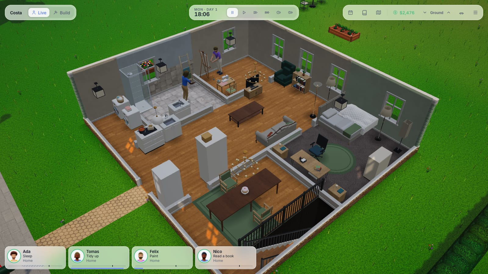
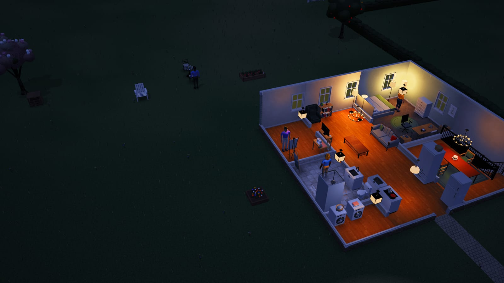
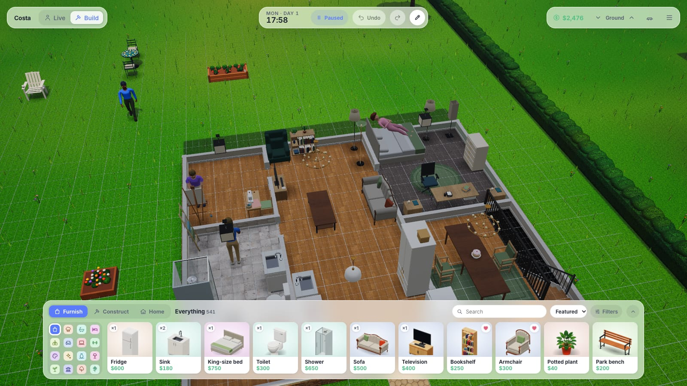
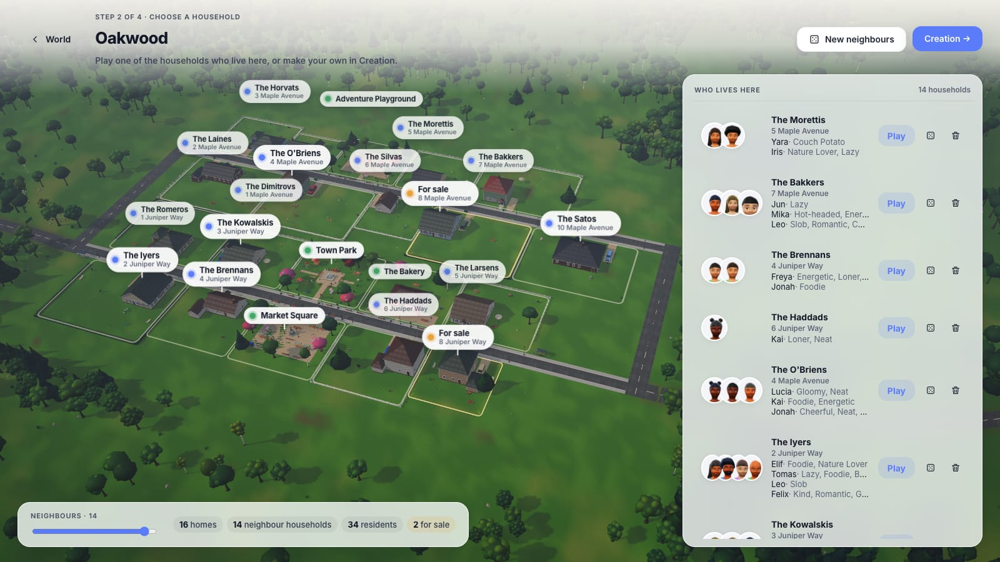
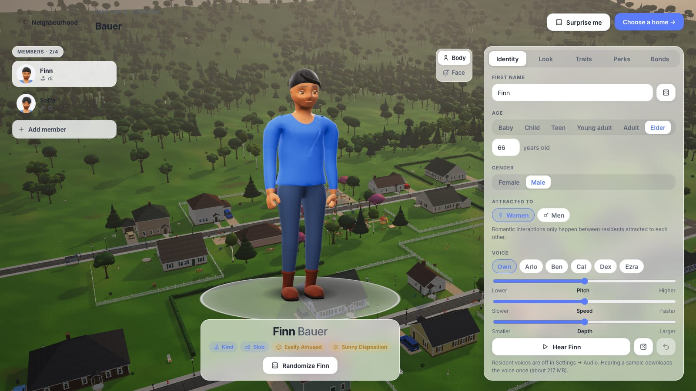
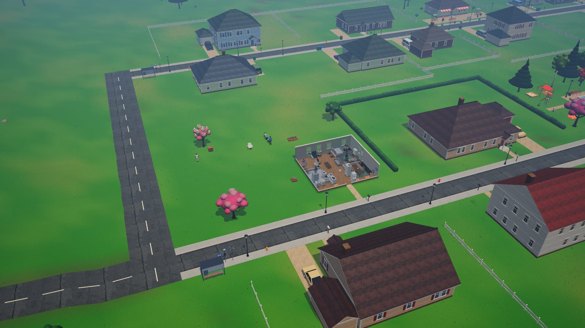
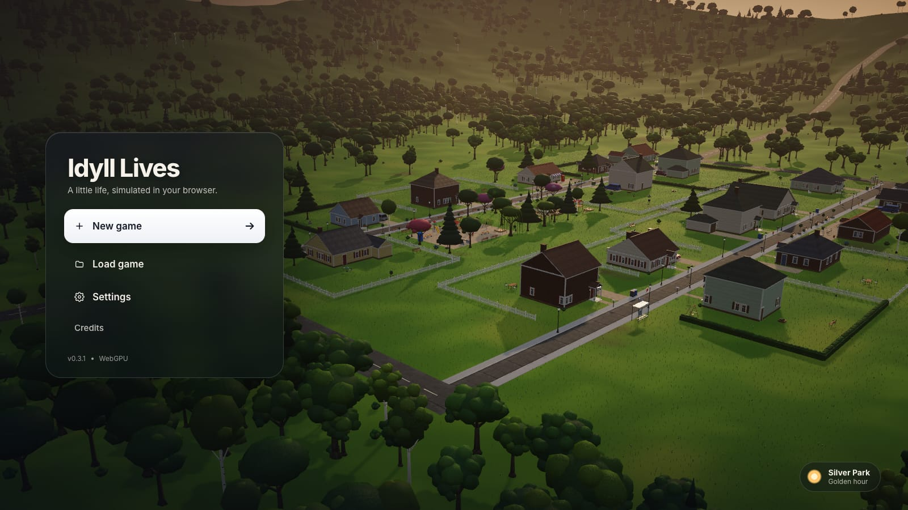

# Idyll Lives

A home-building game with a living town, in the browser: you build and furnish a home, and its residents live in it on their own while you watch. Rust compiled to WebAssembly runs the simulation, PlayCanvas draws it on the GPU (WebGPU, with a WebGL2 fallback) and the interface is Svelte 5. Desktop only.

**▶ Play it in your browser: https://krecks.github.io/idyll-lives/** (desktop Chrome, Edge, Brave or Safari; other browsers use the WebGL2 fallback). The language model for residents' lines needs WebGPU; voices use it when they can and otherwise run on the processor.

## Screenshots



<table>
<tr>
<td width="50%"><br><em>Evening: residents switch the lamps on as they come in.</em></td>
<td width="50%"><br><em>Build › Furnish: over 500 objects, every one built in Blender.</em></td>
</tr>
<tr>
<td><br><em>A new game: a generated town and the households who live there.</em></td>
<td><br><em>Creation: make your own household, from babies to elders.</em></td>
</tr>
<tr>
<td><br><em>The whole town keeps living while you look at one home.</em></td>
<td><br><em>The main menu.</em></td>
</tr>
</table>

## Playing

Build a home and watch the people who live in it.

- **Start:** create a world (a town, a farm, a seaside village, a mountain hamlet, …), choose the neighbours, then play one of the households who already live there or make your own in **Creation**, and move in.
- **Live (L):** everyone in town works, makes friends, falls in love and grows older on their own, your household included. Click a resident to see their needs and plans and to step in; leave the game alone and the camera follows what happens at home.
- **Build (B):** time stands still while you furnish (V), build walls, rooms, doors, windows and stairs (C) and see how each room is doing (O).
- **A life:** 1000 jobs, 13 skills, a weekly planner (P), rent and bills, a garden to grow, and residents who can speak lines of their own (a voice model and a small language model, both run in the browser).

| Input | Action |
|---|---|
| Left-click | A resident: their panel · an object: what to do with it · the floor: walk there |
| Left-drag / right-drag / wheel | Rotate / pan / zoom |
| Space, 0–5 | Pause, game speed |
| L / B | Live / Build |
| F · H · J · P · M | Follow · whole house · journal · planner · town map |
| W | Walls up → cutaway → down |
| Esc | Step back, then the pause menu (save, load, settings) |

Everything else (jobs, skills, money, building, the garden, every control and the graphics settings) is in [docs/playing.md](docs/playing.md). [PLAN.md](PLAN.md) has the research, architecture, milestones and known issues, and [CHANGELOG.md](CHANGELOG.md) what each release brought.

## Run it

Requirements: Rust through rustup (the version is pinned in `rust-toolchain.toml`: 1.99.1 with clippy, rustfmt and the `wasm32-unknown-unknown` target), `wasm-bindgen-cli` 0.2.129 (it must match the `wasm-bindgen` crate in `Cargo.lock`), Bun 1.4 (the version is pinned in `web/package.json`).

```sh
rustup toolchain install       # in the repo: the pinned toolchain, as CI does
cargo install wasm-bindgen-cli --version 0.2.129
cd web
bun install
bun run dev      # builds both WASM modules, fetches the voice and language models, then starts Vite on http://localhost:5173
```

The first `bun run dev` or `bun run build` downloads the voice model (398 MB as published, stored as 185 MB) and the language model (294 MB of weights, stored gzipped as 255 MB) into `web/public/voice/` and `web/public/llm/` (not in git). Every file is pinned and checked by SHA-256, and files already there are kept.

| Command (in `web/`) | What it does |
|---|---|
| `bun run dev` | `wasm`, `voice` and `llm`, then the dev server |
| `bun run build` / `bun run preview` | Production build / serve it |
| `bun run wasm` | Build the simulation's WASM (release, `--locked`) |
| `bun run voice` | Build the voice WASM and fetch the voice model and dictionary (`cargo fetch-voice`) |
| `bun run llm` | Fetch the language model (`cargo fetch-llm`) |
| `bun run check` | Type-check TypeScript and Svelte |
| `bun run lint` | Lint the web code |
| `bun run test` | The renderer's engine-neutral tests (`web/tests`, `bun test`) |
| `bun run check:chunks` | Check that the PlayCanvas internals the renderer patches or reads are still there (`tools/render/check_chunks.ts`; run it after a PlayCanvas upgrade) |
| `bun run test:sim` | Run the Rust simulation tests |
| `bun run test:voice` | Run the voice crate's tests (needs `bun run voice` for the dictionary) |
| `bun run check:voice` | Check the voices in Bun against golden hashes (`tools/voice/check.mjs`) |
| `bun run check:llm` | Check the language model's prompts, cleaning and golden lines in Bun (`tools/llm/check.mjs`; several minutes). Run it by hand when a prompt, a cleaning rule or the model changes, not on every release |
| `bun run devices:llm` | Run the voices and language model's device test in Chromium (`tools/llm/devices.mjs`) |
| `bun ../tools/llm/bench.mjs` | Benchmark the language model on its own: the game's worker, model and prompts with no game around it (load, prompt, tokens a second, the game's five lines), cold and with the page reloaded; writes `bench-results/llm-*/` |
| `bun run assets` | Build or update the compressed asset copies (the build does this too) |
| `bun run decoders` | Refresh `public/decoders` (PlayCanvas's Basis Universal transcoder for KTX2 textures) after a PlayCanvas upgrade (`cargo decoders`) |

From the repo root: `cargo fmt --all` (CI checks the code is formatted) and `cargo clippy --workspace --all-targets -- -D warnings` (CI gates on it), `bun tools/bench/render.mjs` (the rendering benchmark and reference screenshots, see [tools/bench/README.md](tools/bench/README.md) and [docs/design/graphics.md](docs/design/graphics.md)) and `cargo release-version` (the version, see [Versions and releasing](#versions-and-releasing)).

**The production build** also:
- runs binaryen's `wasm-opt -O3` on both WASM files and strips their names (`cargo wasm-opt`; about a minute the first time, then cached in `web/.assets/wasm-opt`). The dev server keeps the WASM as built, with its names;
- writes `bundle.json`: the content, house templates and asset manifests every start needs, in one file. The files still ship one by one beside it;
- writes `THIRD-PARTY-LICENSES.txt` with the licences of the code it bundles, and fails if one is missing;
- gives every runtime fetch from `public/` the build's id (`?v=<id>`), so a new release's data doesn't mix with files cached from the last one. `voice/` and `llm/` are pinned by SHA-256 and left out, and `index.html` itself isn't versioned (Pages lets the browser keep it for 10 minutes).

**Hosting:** the game needs cross-origin isolation for its fastest path (the simulation's snapshots in shared memory). The dev and preview servers send `Cross-Origin-Opener-Policy: same-origin` and `Cross-Origin-Embedder-Policy: require-corp`. GitHub Pages can't, so `index.html` registers a service worker (`public/isolation-sw.js`) that adds the headers, and the page loads once more under it. The worker also keeps the build's hashed files (`assets/<name>-<hash>.js`, `.css`, `.wasm`, `.woff2`) in a cache of the build's own, so returning players load them without asking the server again; a new build's worker deletes the old cache. Without isolation the game still runs, but snapshots are copied instead of shared.

### URL options

| Option | What it does |
|---|---|
| `?quality=low\|medium\|high` | Overrides the graphics preset for this page |
| `?renderer=webgl` | Draws with WebGL2 even where WebGPU works (the game, the previews and the dev pages) |
| `?bench=village` | The rendering benchmark (also `forest`), with `&quality=`, `&hour=`, `&cam=orbit\|wide\|build\|dusk\|mirror\|mirror-still`, `&res=`, `&cap=`, `&diag=` and more ([docs/design/graphics.md](docs/design/graphics.md)) |
| `?hour=13` | Holds the lighting at that hour |
| `?diag=…` | A comma list. `noshadows`, `noaa`, `nonature`, `nolamps`, `nomirrors`, `noglass`, `nonight` leave a feature out to measure what it costs; `freeze` stops time for screenshots; `albedo` and `normals` draw every lit surface as its base colour or world normal; `nosims` leaves the residents out; `linear` draws the light without tone mapping, exposure or grading; `shaders` logs every shader and pipeline compiled, with its material and phase |
| `?debug` | Console helpers: `__controls`, `__world()`, `__sims()` (residents live: where, pose, what they use, needs), `__send(command)`, `__addFunds(n)`, `__camera(pose)`, `__showPlot(i)`, `__characters`, `__renderer` (its debug hooks), and `__crash('panic'\|'throw'\|'hang'\|'render')` to see how the game copes with a failure |
| `?profile` | Logs where start-up and frames spend their time, with a summary once start-up settles (`debug/perf.ts`) |
| `?seed=42` | The random seed of a new game |
| `?pack=packs/my-art/manifest.json` | Loads an extra asset pack (can be repeated) |
| `?look=soft\|classic` | Dev server only: draws in that shading whatever the setting says |
| `?snapshot=0` | Turns off held frames: the menus' town, standing still, is otherwise drawn once and shown again until something in it changes |
| `?shadowrate=<Hz>` | How many times a second the sun's shadow map may be drawn again for the residents' poses (the preset's `shadowRate`; 0: on every change) |
| `?lights=clustered\|forward` | Forces how lamps are lit: every lamp, or the four nearest the biggest rooms (as forward lights on WebGL2; WebGPU has only clustered lighting) |
| `?roomlights=0` | Lets clustered lamps light other rooms than their own, to compare |
| `?lightmix=sun,sky,env` | Scales the look's sun, sky fill and environment light (1 each), to compare one at a time |
| `?state=<name>`, `?debugReport=<name>` | Dev server only: starts in a game state written by the simulation's tests (`DUMP_STATES=1 cargo test`), or in a saved debug report |

The dev server also has pages of their own, not in the build: `/gallery.html` (every model), `/clips.html` (their animations), `/characters.html` and `/poses.html` (the residents), `/previews.html` (portraits and catalog pictures) and `/pcload.html` (the loaders and the material library). On the gallery, clips, characters and poses pages `?ground=0` leaves the lawn out, to compare `diag` views; their other flags are in [tools/bench/README.md](tools/bench/README.md).

## Architecture

```
Main thread                                   Sim worker
┌───────────────────────────────┐            ┌──────────────────────────┐
│ ui/      Svelte HUD (~10 Hz)  │◄─ ui ──────│ sim-wasm → sim-core      │
│ game/    composition + input  │── cmds ───►│ fixed 20 Hz tick         │
│ render/  Renderer (GPU)       │◄─ shared ──│ snapshot (seqlock, SAB)  │
│ assets/  manifest registry    │   memory   │ world geometry on change │
└───────────────────────────────┘            └──────────────────────────┘
```

**Module boundaries.** Each folder can be changed or replaced without touching the others.

| Module | Owns | Must not |
|---|---|---|
| `crates/sim-core` | All game rules: needs, AI, pathfinding, town, social life, saves, geometry generation | Know about browsers, rendering or asset files |
| `crates/sim-wasm` | JS bindings | Contain game logic |
| `web/src/core` | Worker, bridge, protocol, snapshot channel | Render or touch the DOM |
| `web/src/render` | Everything drawn; `types.ts` is the contract (below) | Contain game rules; allocate per frame |
| `web/src/assets` | Key → file resolution | Hard-code art anywhere else |
| `web/src/ui` | Svelte components, design tokens (`theme.css`) | Talk to the worker directly (use `services.controls`) |
| `web/src/game` | Wiring and input (the only place that knows every module) | Grow logic that belongs in a module |

**Performance rules**
- The CPU runs the game; the GPU draws it. The main thread reads one snapshot per tick and draws the world live; the menus' town, standing still, isn't drawn again until something in it changes (held frames).
- Every model is drawn instanced, one draw call per finish group (1–3 for most objects, see [docs/design/objects.md](docs/design/objects.md)); residents are instanced too, posed from one texture of bone matrices of which only the changed rows are uploaded each frame.
- No allocations in the frame loop or the sim tick. The snapshot layout is defined once, in Rust.
- The UI gets changes only, at about 10 Hz, never the whole view and never per frame.
- Import PlayCanvas through `web/src/render/pc/engine.ts`, never as the bare `playcanvas` package (ESLint refuses it): under Vite's dev server the package's entry is PlayCanvas's debug build, which wraps every WebGPU draw in validation error scopes and costs a few frames a second on a full scene; `engine.ts` re-exports the release build by path.

**The renderer** (`web/src/render`, details in [docs/design/graphics.md](docs/design/graphics.md#the-renderer)):

| Folder | Holds |
|---|---|
| `render/pc` | The game's renderer on PlayCanvas 2.23 (`PlayCanvasRenderer.ts`, the `Renderer` of `types.ts`) and what it draws with: the house, street, nature, models, residents, lamps, mirrors, the overview, picking, build tools, post-processing; `shaders/` holds the game's shader features in GLSL and WGSL |
| `render/shared` | What any engine would need, with no engine in it: the camera's controls (`orbit.ts`), the maths in the game's conventions, mesh builders, the residents' behaviour (`characters/`), birds, build effects, image-processing uniforms, frame pacing; tested by `bun run test` |
| `render/preview` | The previews on PlayCanvas apps of their own: the household creator's resident, portraits, the catalog's pictures and turntables |

Game space is left-handed (x east, y up, z north), as the simulation, the generators and the residents' files have it; PlayCanvas is right-handed, so the world hangs under one root mirrored in z and `render/pc/space.ts` is the only place that converts (cameras, lights, picking rays, projected points, mirror planes). The game's shader features reach PlayCanvas's standard material as chunk overrides gated by their own defines, plus a few engine-wide patches; `bun run check:chunks` (in CI) checks that every engine line they rely on is still there.

## Replacing art

All art is referenced by **key**, never by path:

- `web/public/content/base.json`: gameplay data. Objects name their model key (`"model": "model.fridge"`); needs name their icon key.
- `web/public/assets/manifest.json`: maps keys to files.

A model entry is its file, with what the game needs to know about it. Every object's model is a glTF built in Blender (`tools/art/blender`, `cargo art`), listed in a pack per family (`assets/packs/<family>/manifest.json`, all under the base manifest's `"packs"`): `materials` maps each material to one of the game's finishes, `paint` names the parts the player can colour, and `motions` the clips a use plays (here, shortened):

```json
"model.fridge": {
  "type": "model",
  "url": "../../models/kitchen/fridge.glb",
  "materials": { "body": { "finish": "material.finish.gloss" }, "chrome": { "finish": "material.finish.chrome" } },
  "motions": { "uses": { "fetch": "fridge_open", "frozenTreat": "freezer_open" }, "hold": 3.5 },
  "paint": [{ "material": "body", "label": "Body" }, { "material": "chrome", "label": "Handles" }]
}
```

A model file that fails to load is drawn as a stand-in box the size of the object, and tried again in the background.

To ship a whole art set without editing the base manifest, create a pack and list it under `"packs"` (or load it with `?pack=`):

```json
// web/public/assets/packs/hd/manifest.json — keys here override the base manifest
{ "version": 1, "entries": { "icon.need.hunger": { "type": "icon", "url": "icons/hunger.png", "mode": "image" } } }
```

Model conventions: 1 unit = 1 metre, origin at the footprint centre on the floor, front facing +Z. How to build a new object in Blender (scale, budgets, finishes, export, checks): [docs/design/objects.md](docs/design/objects.md). Monochrome SVG icons are recoloured by CSS (`mode: "mask"`); use `mode: "image"` for full-colour art.

## Adding gameplay content

Everything gameplay-related is JSON in `web/public/content/`:

- `base.json`: needs, genders, traits, perks, objects, **social interactions** (requirements, success chances, outcomes, animation), emotions, feelings, bond presets, social rules, **careers** (levels, pay, hours, workdays, work effects), **daily schedule** windows, visit rules, starting funds, story-feed texts.
- `houses.json`: house layouts and the park, stamped onto town plots.

Add an object to `content/base.json` or one of the files it `include`s (the catalogue is in `furniture.json`, `garden.json`, `community.json`, `catalog2/` and `packs/`: footprint, interactions, need effects, model key) and its model key to the manifest; homes are furnished from `houses.json` and `housegen.json`, or bought in the game. (`content/lots/starter.json` is only for the tests and the pack checker.) Content is checked when it loads: a value that would break the game is refused with the file and id in the message. `cargo test` validates the shipped content (`crates/sim-core/tests/shipped_content.rs`).

A production build serves the content from `bundle.json`, which wins over the loose files: to edit content inside a built site, rebuild it or delete `dist/bundle.json`.

Pack authors: see [docs/content-packs.md](docs/content-packs.md). The look of the world is described in [docs/design/look.md](docs/design/look.md), the graphics settings in [docs/design/graphics.md](docs/design/graphics.md).

## Versions and releasing

The current version is **0.5.1**. One version number covers the whole game: `web/package.json` (shown in the main menu and Credits, with the commit it was built from), the Rust workspace in `Cargo.toml` and the workspace crates' entries in `Cargo.lock`. `cargo release-version` prints it and fails if they differ (CI checks this); `cargo release-version 0.3.0` sets all three. Each release is a git tag `vX.Y.Z` with notes in [CHANGELOG.md](CHANGELOG.md).

Saves have their own format version, `SAVE_VERSION` in `crates/sim-core/src/save.rs`: 33 since 0.5.0, also in 0.5.1 (32 in 0.3.1 to 0.4.2, 29 in 0.3.0, 23 in 0.2.0; 0.1.0 wrote 17). Older saves are migrated when they load, and `crates/sim-core/tests/old_saves.rs` loads real saves from 0.1.0 and the build after it. A save from a newer version is kept and skipped, and a damaged one is removed with a notice.

**Releasing** (`.github/workflows/pages.yml`):
1. `cargo release-version <x.y.z>` (it updates `Cargo.lock` too, so no `cargo build` is needed), and a `## <x.y.z> — <date>` section in CHANGELOG.md, with the date set by hand. Commit both on `main`, and `git push origin main`: the dry run builds what GitHub has.
2. A dry run on `main`: `gh workflow run pages.yml --ref main -f deploy=false`. `gh run watch` needs the run's id: `gh run list --workflow pages.yml -L1 --json databaseId -q '.[0].databaseId'`, then `gh run watch <id> --exit-status`. It runs everything a release runs (clippy with `-D warnings`, the simulation tests, tickbench, the voice tests, `bun run check:voice`, `check`, `lint`, `check:chunks` and `test`, the build, a size check under 900 MB) without publishing. It works on any branch, and `-f deploy=true` publishes. Run it on `main` just before tagging: the caches it saves there (voice and language models, assets) can be read by the tag's run.
3. Tag and push: `git tag -a v<x.y.z> -m "..."` and `git push origin v<x.y.z>`. The tag's run checks that the tag matches the version and that CHANGELOG.md has its heading, builds, and publishes to GitHub Pages. Pushes to `main` alone don't publish. Watch it as in step 2 (`gh run list --workflow pages.yml --event push -L1 …`), and don't start other runs while it waits: GitHub keeps only one waiting run per concurrency group and cancels the older one.
4. Check the live site:
   - The menu shows the new version, and Credits "Version <x.y.z> (build <the tagged commit>)". (To find the version in the bundle, search `index-*.js` for it without double quotes: it sits in backticks.)
   - F3 shows Shared memory: on, and a game runs.
   - The large files download in full, which only the live site can show: `llm/lfm2.5-350m/model_q4.onnx_dataz` returns 200 and is 254,923,309 bytes (gunzipped, its SHA-256 is the one in `crates/tools/src/llmfetch.rs`), and `voice/supertonic-3/vector_estimator.onnxz` is 119,556,677 bytes (packed by the Rust fetch tools; files CI still has cached from the earlier tools are 255,530,880 and 119,568,968 bytes, and are as good: what matters is the unzipped SHA-256).
5. Publish the release notes: `gh release create v<x.y.z> --verify-tag --title "Idyll Lives <x.y.z>" --notes-file <the version's CHANGELOG section>`.

**If a release goes wrong,** fix forward, or redeploy the last good build (`gh workflow run pages.yml --ref <tag> -f deploy=true`). 0.5.0 and 0.5.1 share save format 33, so 0.5.0 is a safe build to go back to; 0.4.2 can't open format 33, so it is one to go back to only with that in mind (0.3.1 to 0.4.2 share format 32); 0.3.0 can't open 0.3.1's saves (format 32), 0.2.0 can't open 0.3.0's (format 29), and v0.1.0 can't open 0.2.0's database (version 2): an older build keeps the newer saves and skips them, so it lists only the saves it can open. Nothing is lost; the saves come back with the newer build.

Each CI run keeps the site's WASM with function names as an artifact for 90 days (`wasm-with-names-<sha>`). It runs the same optimisations as the site with the name section kept, so its function numbers match the shipped WASM and a crash stack from the site can be read with it.

## Licence

Idyll Lives is free software, released under the [GNU General Public License v3.0 (or later)](LICENSE). You may use, study, share, and modify it; if you distribute Idyll Lives or a modified version, you must make the source available under the same licence. Third-party parts keep their own licences: the art listed in [`web/public/assets/CREDITS.md`](web/public/assets/CREDITS.md) is CC0, the voice model (Supertone's Supertonic 3) is under the BigScience OpenRAIL-M licence (with its use restrictions), the dictionary is Apache-2.0, and the optional language model for residents' lines (Liquid AI's LFM2.5 350M) is under the LFM Open License v1.0 (all listed there). Every production build also writes `THIRD-PARTY-LICENSES.txt` with the licence texts of the code it bundles (PlayCanvas, Svelte, ONNX Runtime Web, the Rust crates in the WASM and others) and of the code ported into the game's own: parts of the renderer are ported from Babylon.js (Apache-2.0; each such file says so, and its licence and notice are in `crates/tools/texts/`); the in-game Credits link both.
